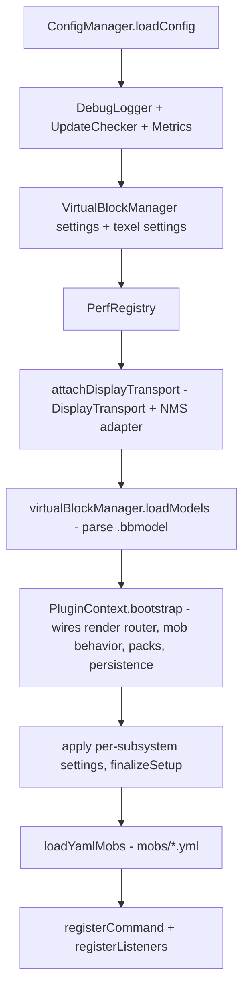
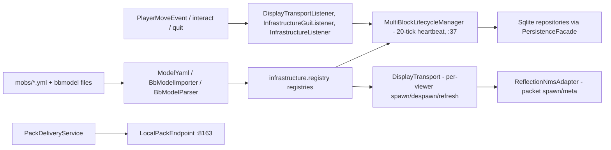

# 01 Architecture map

Facts re-checked against the tree on 2026-11-25. 353 Java files, 64,967 lines (`src/main/java`), one Gradle module, no CI. `build.gradle:10` compiles Java 21 against Spigot 1.21.1 stub jars in `libs/` only — deliberately no `paper-api` on the classpath (`build.gradle` comment), so every Paper/Folia seam is reflective behind a probe.

## Module inventory

| Package (`src/main/java/com/mineplus/`) | Role | Key classes |
| --- | --- | --- |
| `MineplusPlugin` | Entry point, `onEnable` order below | `MineplusPlugin.java` |
| `config` | Config load, defaults, per-subsystem settings objects | `ConfigManager` |
| `infrastructure.core` | Multiblock registry, lifecycle, machine GUI, storage engine, api facades | `MultiBlockLifecycleManager`, `AbstractMachineGui`, `InfrastructureApi` |
| `infrastructure.virtual` | Virtual/display blocks, display-entity transport, NMS reflection, animation, `BbModelImporter` | `DisplayTransport`, `ReflectionNmsAdapter`, `ModelAnimationManager` |
| `infrastructure.mob` | Custom mob YAML loading, render engine, behavior engine, model parser | `CustomMobManager`, `MobRenderEngine`, `BbModelParser` |
| `infrastructure.persistence` | SQLite via HikariCP, repository, migration runner | `PersistenceFacade`, `SqliteMigrationRunner` |
| `pack` | Resource pack compile, item/block model generation, rig export, delivery endpoint | `PackDeliveryService`, `PackItemFactory`, `LocalPackEndpoint` |
| `infrastructure.command`, `input`, `fx`, `hud`, `combat`, `content`, `definition`, `listener`, `model`, `module`, `perf`, `registry`, `render`, `world` | Command routing, input probes, effects, HUD, stance/combat, definitions, perf registry, module SPI, registries | — |
| `util` | `SchedulerCompat`, `ServerVersion`, debug, update check | `SchedulerCompat` |
| `bstats` | Vendored metrics | — |
| `devtools/blockbench-plugin` | Blockbench plugin (JS), `mineplus_generic_display.js` v6.1.0, own node test | — |

## Startup order (`MineplusPlugin.onEnable`, :36-71)

## Registry and event flow

Threading model today: everything user-facing runs on Bukkit's main/scheduler threads through `BukkitRunnable`/`runTaskTimer` (17 raw sites, `02` F1), except the async pack build and SQLite pool (size 1, `SqliteConnectionFactory.java:43`). `SchedulerCompat` (`util/SchedulerCompat.java:30,50`) wraps 10 sites and is the intended unification point. Shared mutable state: instance maps in `VirtualBlockManager`/`DisplayTransport` (chunk index at `DisplayTransport.java:85`), accessed from move and tick paths.

## Data flows

**Custom block:** definition YAML → registry → spawn places interaction/display entities via `DisplayTransport` → client renders pack model → player interact → `MultiBlockLifecycleManager` state change → dirty state to `SqliteMultiBlockRepository`.

**Custom item:** pack item definition → `PackItemFactory` → `ItemMeta` + reflection for `item_model` (`pack/item/PackItemFactory.java:166`) → pack generated → delivered over `LocalPackEndpoint`.

**Custom mob:** `mobs/*.yml` + `.bbmodel` → `MobYamlLoader`/`BbModelParser` → `CustomMobManager` spawn → `MobBehaviorEngine` goals on Bukkit scheduler → `MobRenderEngine` bone transforms → `ModelAnimationManager` keyframes → packets via NMS adapter.

## Public API surface inventory

What a third-party dev can reach: `InfrastructureApi` / `BasicInfrastructureApi` / `JsonInfrastructureApi` (`infrastructure/core/api/`), obtained through `PluginContext` and its seven `bootstrap` overloads (`infrastructure/PluginContext.java:113-217`). There are **no Bukkit events fired, no ServicesManager registration, no `@since` markers and only 3 `@Deprecated`** (zero-hit grep, `02` F9). Stability rating: everything is effectively internal; the three facades are semi-stable (used by `examples/`) but versioned only by the plugin version.

## Blockbench plugin inventory

`mineplus_generic_display.js` v6.1.0: bones, cube meshes, per-bone textures, animations export, hitbox metadata, generic-display format consumed by both `BbModelImporter` (blocks/furniture) and `BbModelParser` (mobs). Duplicated parsers are finding F17. Node test at `devtools/blockbench-plugin/test/`.

## Assumptions not verified

- Per-tick frequency of the `getNearbyEntities`/`getOnlinePlayers` call sites (F11) — need a profiler run.
- Whether the GUI exploit (F3) actually reproduces — needs a server.
- Whether `ReflectionNmsAdapter` caches its `ServerPlayer` handle (F12).
- Blockbench plugin feature claims are from their own README, not exercised here.
